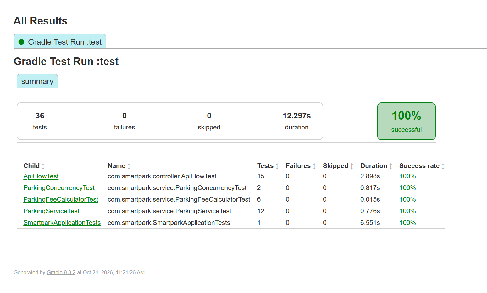

# SmartPark — Parking Management API

Spring Boot REST API for registering parking lots and vehicles, checking vehicles in and out,
and tracking occupancy. Java 21, Spring Boot 4, Gradle, H2 (in-memory), JWT.

## Prerequisites
- JDK 21 (no Gradle install needed; the wrapper is included)

## Build, run, test
./gradlew clean build      # compiles and runs all tests
./gradlew bootRun          # starts on http://localhost:8080
./gradlew test             # tests only

## Credentials
POST /api/auth/login with {"username":"admin","password":"admin123"} returns a JWT.
Send it as Authorization: Bearer <token> on every other endpoint. Tokens last 60 minutes.

## Endpoints
| Method | Path | Purpose |
|---|---|---|
| POST | /api/auth/login | Get a token |
| POST | /api/lots | Register a parking lot |
| GET | /api/lots | List lots |
| GET | /api/lots/{lotId}/occupancy | Capacity, occupied and available spaces |
| GET | /api/lots/{lotId}/vehicles | Vehicles currently parked in the lot |
| POST | /api/vehicles | Register a vehicle |
| GET | /api/vehicles | List vehicles |
| POST | /api/parking/check-in | Park a vehicle in a lot |
| POST | /api/parking/check-out | Leave a lot; returns minutes and cost |

Errors are JSON: timestamp, status, error code (e.g. LOT_FULL, ALREADY_PARKED, NOT_PARKED,
VALIDATION_FAILED, UNAUTHORIZED), message, path.

## Preloaded data
Lots: LOT-MKT-01 (50 spaces), LOT-BGC-01 (30), LOT-TINY (2, for testing the full-lot case).
Vehicles: ABC-1234, XYZ-987, TRK-5501, NCR-4321, MC-2025.
H2 console: http://localhost:8080/h2-console (JDBC URL jdbc:h2:mem:smartpark, user sa, no password).

## Testing the API
- Postman: import postman/SmartPark.postman_collection.json and run "Login" first; the token is saved
  automatically for the other requests.
- curl: see docs/curl.md.

## Assumptions
- Parking cost = billed minutes × lot cost per minute. Minutes round up, minimum 1.
- Vehicles parked more than 15 minutes are removed automatically. Billing is capped at 15 minutes, and
  auto-removed sessions are closed as of check-in + 15 minutes, regardless of when the scheduler runs.
- The scheduler polls every 30 s (configurable), so removal happens within one interval after the limit.
- License plates are stored uppercase; lot IDs are stored as given.
- A single static user from application.yml (BCrypt-hashed in memory).

## Concurrency
- Full lot: occupancy is incremented with a conditional UPDATE (... WHERE occupied < capacity) under
  the row lock; 0 rows updated means the lot is full.
- One lot at a time: parking_session.active_plate is unique and set only while a session is ACTIVE.
  A racing second check-in fails on insert and its transaction (including the occupancy increment) rolls back.
- Check-out vs auto-removal: a session is closed with UPDATE ... WHERE status = 'ACTIVE'; only the
  caller that updates the row releases the space, so it is released exactly once.
- No JVM locks, so the design also holds with several instances.

## Considered alternatives
- Per-vehicle timers would remove cars at exactly 15:00 but are lost on restart and don't work across
  instances without a recovery job. Polling is simpler and self-healing.

## Test results
- Summary: 
- Full HTML report: open `docs/test-results/index.html` in a browser after cloning
- Console output: [docs/test-results/test-output.txt](docs/test-results/test-output.txt)
- Re-run anytime with `./gradlew clean test`